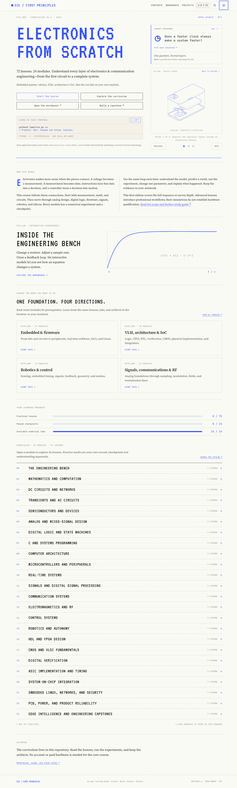

# ECE from First Principles

**[Start the free interactive course →](https://shreyasshekar-gx.github.io/ece-from-first-principles/)**

**From the first circuit to the whole system.** An original, open learning repository for electronics and communication engineering.

Learn through a connected sequence of **24 modules, 72 concise lessons, 24 Python numerical experiments, 24 module checkpoints, six browser simulators, and five capstone reference projects**. Follow the complete journey or a prerequisite-aware path for embedded systems, robotics, VLSI/architecture/SoC, or communications/RF.



## Start here

No account, API key, board, or paid EDA tool is required for the core course. Python 3.10+ runs the numerical labs; a modern browser runs the site. Node.js is needed to update the bundled illustration library, rebuild, or run JavaScript checks.

```bash
# From this repository's root:
python3 -m http.server 8073 --bind 127.0.0.1
```

Open **[the learning site](http://127.0.0.1:8073/site/)**. Use HTTP serving for the Hairline ES modules and consistent browser storage. The site does not fetch external scripts, fonts, or analytics.

Prefer Markdown? Start with [the engineering notebook](lessons/00-bench/01.md), or browse the [complete curriculum](CURRICULUM.md).

```bash
python3 labs/run.py rc
python3 labs/run.py rc --sweep 2
python3 projects/reference.py tiny-cpu
```

## What is included

| Area | Modules |
|---|---|
| Foundations | Measurement, mathematics, DC networks, transients, AC |
| Electronics | Semiconductor devices, analog/mixed-signal, PCB, power, reliability |
| Computing | Digital logic, C/memory, CPU datapaths, pipelines, caches |
| Embedded | Microcontrollers, serial interfaces, interrupts/DMA, RTOS, Linux, networking, security |
| Signals | Sampling, FIR/DFT, modulation, noise, link budgets, electromagnetics, RF |
| Robotics | Feedback, PID, state-space, kinematics, odometry, planning |
| Silicon | RTL/FPGA, CMOS/VLSI, verification, timing, ASIC flow, SoC integration |
| Integration | Edge inference, resource budgets, five capstones, portfolio evidence |

Each lesson contains an explanation, a relationship, a worked example, a misconception, an exercise with solution, a shared module experiment, and further reading. The third lesson in each module includes a graded conceptual checkpoint.

The website includes search, four focused paths plus the complete path, a lesson reader, notes, self-reported practice marks, checkpoints, JSON progress import/export, and six interactive models: RC charging, aliasing, PWM, reflections, feedback, and dynamic power.

**Edition 0.1 is a complete introductory survey sequence, not an exhaustive A–Z professional textbook.** Advanced subjects are concise introductions. Python reference models are not hardware implementations. The optional C and SystemVerilog exercises bridge toward lower-level tools. Read [SCOPE.md](SCOPE.md) for specialist topics requiring expansion and hardware/tool qualification.

## Learn with an agent

Ask your coding assistant:

> Use `skills/ece-tutor/SKILL.md` in this repository. Start my ECE learning plan and teach one lesson at a time. Ask me to predict before running a lab, and keep my evidence in LEARNING.md.

The [tutor skill](skills/ece-tutor/SKILL.md) uses local lessons and records progress without pretending that reading equals mastery. It is packaged in the repository; no global agent configuration has been modified. Once you publish your own GitHub repository, its `skills/` directory can be distributed through compatible skill installers. There is no published package or invented install URL for this project yet.

## Projects

1. [A trustworthy sensor node](projects/sensor-node/README.md): acquisition → quantization → filtering → framing.
2. [A robot that can explain its motion](projects/robot-controller/README.md): differential-drive simulation and analytic checks.
3. [A tiny processor you understand](projects/tiny-cpu/README.md): a teaching ISA with defined errors and wraparound.
4. [A reproducible digital radio link](projects/digital-link/README.md): seeded BPSK/AWGN experiment against theory.
5. [A well-specified SoC peripheral](projects/soc-peripheral/README.md): FIFO register interface and corner-case tests.

The references run now. Each brief separates demonstrated simulation behavior from proposed extensions such as real DMA acquisition, a physical robot, a compliant RISC-V core, or an RTL bus wrapper.

## Repository map

```text
content/              Original authored curriculum and project definitions
lessons/              Generated, readable Markdown lessons
labs/                 Numerical models, experiment runner, C and RTL exercises
projects/             Project briefs and executable reference models
site/                 Static learning website with bundled Hairline illustrations
skills/ece-tutor/     Agent tutor instructions
scripts/              Deterministic build and curriculum audit
tests/               Numerical, project, browser, and catalog checks
research/             REA reference-page evidence and interpretation
artifacts/            Locally captured site previews
```

Edit the source under `content/`, then rebuild. Do not hand-edit generated lessons, `catalog.json`, or `site/data.js`.

```bash
npm ci --ignore-scripts
npm run build
python3 scripts/audit.py
python3 -m unittest discover -s tests -v
node tests/test_simulators.cjs
```

[The lab guide](labs/README.md) explains every sweep parameter and the optional C/RTL commands. [TESTING.md](TESTING.md) distinguishes checks actually run from optional tool-dependent checks. [CONTRIBUTING.md](CONTRIBUTING.md) defines the standard for new lessons.

## Publish your copy

The site is static. Run `npm ci --ignore-scripts` and `npm run build` and publish the **contents of `site/`** to any static host. Hash routing needs no server rewrite rules. A manual GitHub Pages workflow is included; after pushing to your own repository, choose GitHub Actions as the Pages source and run the `Publish course` workflow. Repository ownership, remote creation, and publication are not performed by the local build.

## Provenance and license

The pedagogical format was inspired by [Rohit Ghumare’s AI Engineering from Scratch](https://github.com/rohitg00/ai-engineering-from-scratch). [REA](https://github.com/morluto/rea) 6.7.0 was actually used to inspect the reference website; see [research/README.md](research/README.md) for commands, evidence identity, findings, and limits. The ECE lessons and numerical models are original. The website adapts the reference’s blueprint-paper visual system, examined using [web-ui-copy](https://github.com/koppx/web-ui-copy). It bundles `@lucasmarkes/hairline` 0.5.1 for three interactive conceptual illustrations. See [DESIGN.md](DESIGN.md) and [THIRD_PARTY_NOTICES.md](THIRD_PARTY_NOTICES.md) for design evidence and licenses.

Further reading links to primary sources including MIT OpenCourseWare, RISC-V, OpenROAD, Linux, KiCad, and ROS documentation. Linked material retains its own license and does not imply endorsement. This repository’s original material is [MIT licensed](LICENSE).
